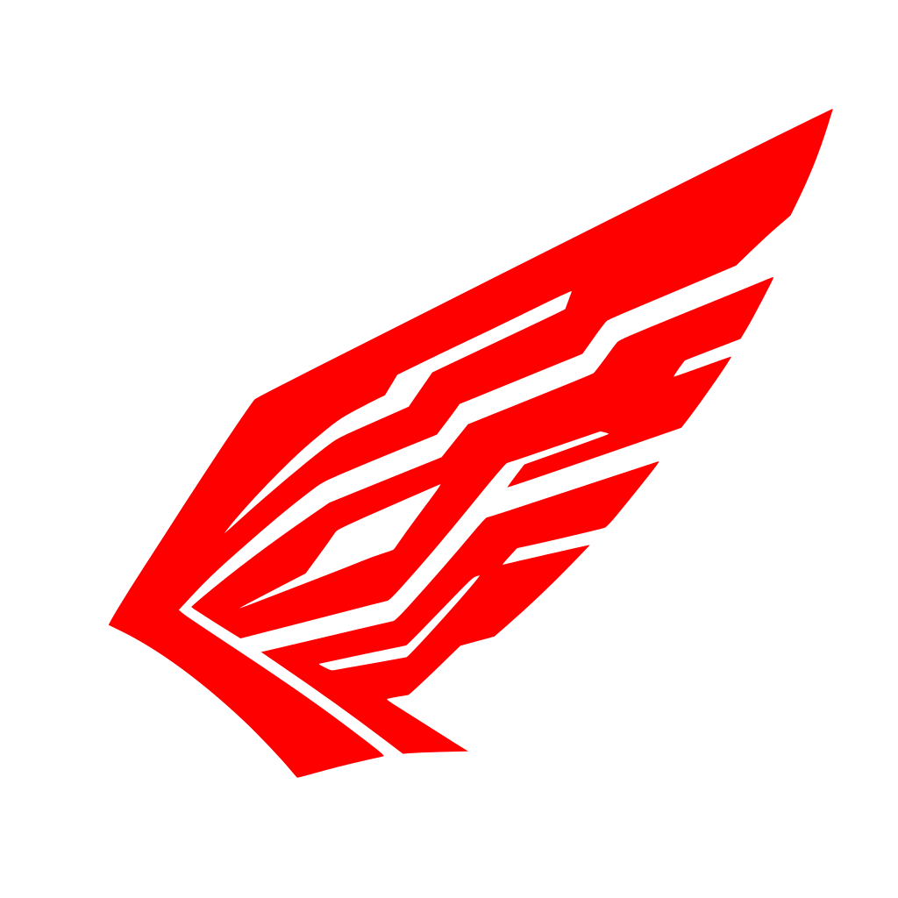
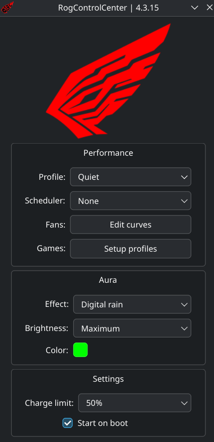
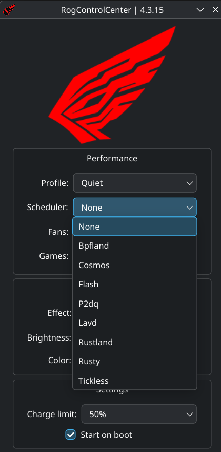
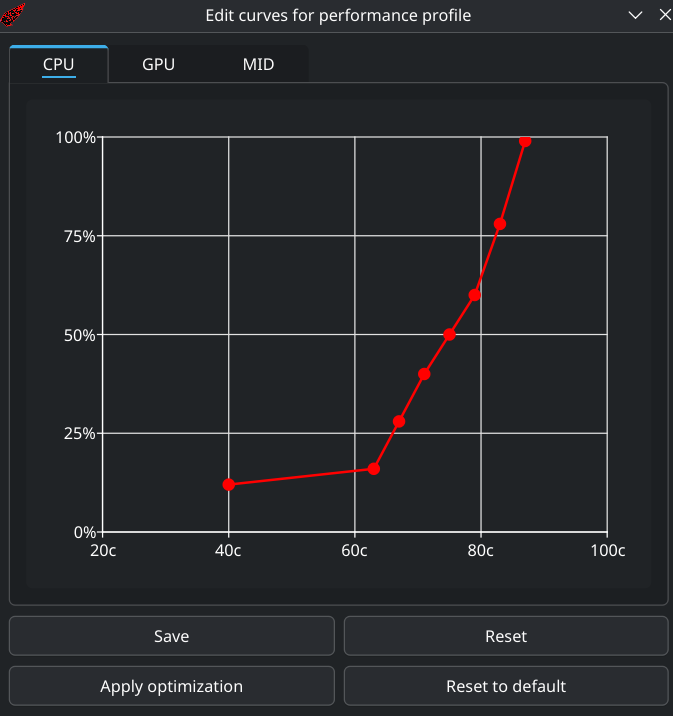
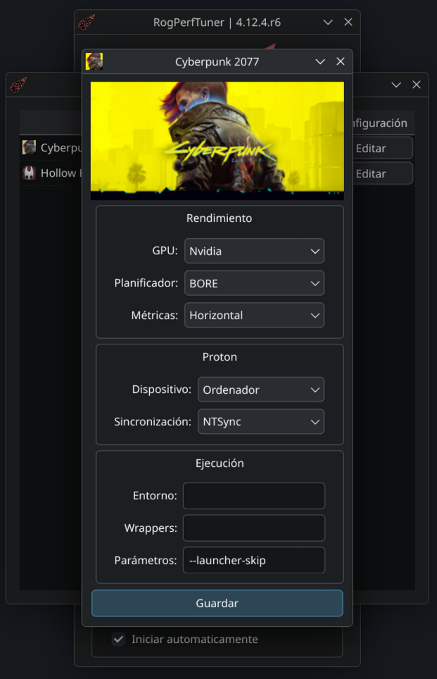

<h1 align="center">

  <br>
  RogPerfTuner
  <br>  
  <p align="center">
    <a href="https://github.com/Emiliopg91/RogPerfTuner/actions/workflows/push.yml"></a>
    <a href="https://deepwiki.com/Emiliopg91/RogPerfTuner"></a>
    <br>
  </p>
</h1>

## Index

- [Description](#description)

- [Features](#features)

- [Installation](#installation)
  - [AUR](#aur)
  - [Steam and DeckyLoader integration](#steam-and-deckyloader-integration)

- [Development](#development)

- [Compatibility](#compatibility)

- [Attribution](#attribution)

## Description

Are you tired of having to manually adjust operating system settings to get the most out of your Asus ROG?

Do you want breathtaking RGB effects on your laptop and peripherals? And with synchronized effects across all your RGBs?

What if I told you you can also integrate with Steam and assign which GPU to use from a graphical interface, and view performance metrics?

RogPerfTuner is here to simplify your life and help you enjoy gaming on your Asus ROG laptop once and for all.

Do you want something similar for Asus Rog Ally/Ally X? Check [AllyDeckyCompanion](https://github.com/Emiliopg91/AllyDeckyCompanion/)

|      |               |
| --------------------------------------------------------- | ---------------------------------------------------------------- |
|  |  |

## Features

- [x] Features detected at startup based on your laptop capabilities

- [x] Choose the performance profile that best fits your needs:
  - Smart: Automatically switches between profiles depending on system load.
  - Performance: Maximizes system performance with no compromises.
  - Balanced: The sweet spot between performance and system stress.
  - Quiet: Prioritizes silence and power efficiency by reducing performance.

  Each profile controls:
  - CPU TDP
  - CPU Boost
  - CPU Governor
  - CPU Scheduler
  - GPU Boost
  - GPU Thermal throttling policy
  - Fan curves, customizable via charts
  - Power profile
  - SSD IO scheduler

- [x] RGB control for Asus ROG laptops and peripherics and support for custom AuraSync

- [x] Available RGB effects:
  - **Breathing**: Feel every breath
  - **Dance floor**: Every led dancing at rithm
  - **Digital rain**: Matrix like animation that speeds up as your CPU is more demanded
  - **Drops**: Feel every drop of rain fallin over you
  - **Gaming**: Highlights most used in game keyboard keys
  - **Rainbow wave**: A rainbow sliding on your leds
  - **Spectrum cycle**: A cycle of every color of RGB spectrum
  - **Starry night**: Stars blinking on your devices
  - **Static**: A classic solid color effect

- [x] Select color for the effect (only available on Breathing, Digital Rain and Static effect)

- [x] Allow changing RGB brightness
  - Off
  - Low
  - Medium
  - High

- [x] Limit battery charge threshold to maintain its life-span
  - 100%: If you requires full battery without bothering about its health
  - 75%: If you want big battery capacity saving its health
  - 50%: for laptops that are always connected to AC

- [x] Wrapper to apply optimization to applications (standard and flatpak)

- [x] Steam integration through Decky plugin
  - Interception of game first run to change it's launch option to use our custom wrapper
  - Force use of dGPU or letting Linux select for you
  - Show performance metrics
  - Adjust process CPU and IO priority
  - Support for flatpak added

- [x] Start on boot

## Installation

### AUR

Mainline AUR package is available as **rog-perf-tuner**.

If you prefer bleeding-edge version with latest features, fixes and improvements you can install **rog-perf-tuner-git**.

Install it using your favourite AUR helper and you'll get every dependency installed.

### Steam and DeckyLoader integration

To enable Steam integration, you should install Steam and DeckyLoader previous to the first run of RogPerfTuner. If you've already launched RogPerfTuner you can delete ~/.RogPerfTuner and perform Steam and DeckyLoader installation.

## Development

RogPerfTuner is a [Tauri](https://tauri.app/) application: a Rust backend (`src-tauri`) and a React + MUI
frontend (`src`). It drives a bundled, patched [OpenRGB](https://github.com/Emiliopg91/OpenRGB) build for
lighting and ships the [RccDeckyCompanion](https://github.com/Emiliopg91/RccDeckyCompanion) Decky plugin,
both as git submodules.

```bash
git submodule update --init --recursive
make run      # builds the bundled assets (first time only) and runs `tauri dev`
make test     # backend unit tests
make lint     # eslint + tsc + clippy
make build    # release binary in src-tauri/target/release
```

Every client, server and lighting effect lives in its own file, grouped in submodules; each `mod.rs` only holds
what its module shares.

| Path | Contents |
|------|----------|
| `src-tauri/src/models` | Config (`config.yaml`), profiles, fan curves, socket messages |
| `src-tauri/src/clients/file` | sysfs/procfs clients (battery, boost, governor, schedulers...) |
| `src-tauri/src/clients/file/firmware/asus_armoury` | One file per asus-armoury attribute (PL1/2/3, Nvidia, boot sound, panel OD) |
| `src-tauri/src/clients/shell` | asusctl, scxctl, flatpak |
| `src-tauri/src/clients/dbus` | asusd platform, desktop notifications |
| `src-tauri/src/clients/lib` | USB devices (sysfs instead of libudev) |
| `src-tauri/src/clients/unix_socket` | Decky plugin and running instance clients |
| `src-tauri/src/clients/tcp/open_rgb` | OpenRGB client, SDK protocol and one file per effect |
| `src-tauri/src/services` | Application, hardware, OpenRGB, performance, Steam, configuration |
| `src-tauri/src/servers` | Unix socket server |
| `src-tauri/src/utils` | Logger, shell, event bus, translations, files, processes... |
| `src-tauri/src/cli.rs` | `-p -e -i -d -s -k -m -v -h -r -f --completion` |
| `src-tauri/src/commands.rs`, `events.rs`, `dto/` | Frontend API |
| `src-tauri/src/tray.rs` | Tray menu |
| `src/` | React UI (main window, games, game config, fan curve editor) |

`src/utils/backend/{models,client,listener}.ts` are generated by
[`tauri-rs-ts-ipc`](https://crates.io/crates/tauri-rs-ts-ipc) on every debug run, don't edit them. Frontend
types live in `src-tauri/src/dto` (no serde renames) and every `emit` lives in `src-tauri/src/events.rs`.

## Compatibility

- Only tested on Laptops with Intel+Nvidia settings

## Attribution

Thanks to the following for making this plugin possible:

- [Bazzite](https://github.com/ublue-os/bazzite/) thank you because you made Linux gaming beautiful for me

- [Asusctl](https://gitlab.com/asus-linux/asusctl/) for giving the base for performance profiles

- [OpenRGB](https://gitlab.com/CalcProgrammer1/OpenRGB/) base of the custom version for this project

- [MangoHUD](https://github.com/flightlessmango/MangoHud/) used for showing performance metrics in-game

- [Gamemode](https://github.com/FeralInteractive/gamemode/) to give inspiration about game processes optimizations

- [Decky loader](https://github.com/SteamDeckHomebrew/decky-loader/) for allowing Steam integration
